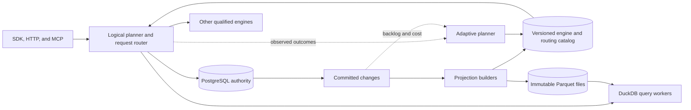

# LamedDB adaptive multi-engine implementation plan

LamedDB can run as many qualified engines side by side as the workload justifies. An application calls the same `put`, `get`, `query`, and stream APIs as it does today. LamedDB decides which engine serves each operation, which representations to maintain, and when to add, scale down, or retire one. The design covers several engines serving one collection, several engines owning different collections or partitions, and one query that uses more than one engine.

## What concurrent operation looks like

| Workload in the same workspace | Example route | How it coexists |
| --- | --- | --- |
| Checkout updates, point reads, and selective order lists | PostgreSQL record authority and indexes | Serves transactional traffic and keeps the record, retry receipt, and optional event atomic. |
| Revenue across 90 days of orders | DuckDB workers over a Parquet projection, with PostgreSQL supplying any changed records needed for the exact snapshot | Runs broad scans in a separate pool while checkout continues. Uses a synchronous rollup if it already answers the query at lower cost. |
| A future supported text search on order notes | A qualified inverted-index adapter | Serves a third workload with its own capacity and visibility checks. Uses a declared ranking contract and fetches records at a compatible snapshot when required. |
| An append-heavy event collection | A qualified segmented log as its write authority | Can own a different collection while the record and analytics engines are active. Its logical ordering, retry, and retention guarantees govern placement. |

The first real pair is **managed PostgreSQL and a separate DuckDB execution pool over versioned Parquet projections**. Two requests can use the two engines at the same time. A third engine can be registered through the same interface and used concurrently when qualified. TiDB provides a precedent for routing between row and column representations, including using both in one query. DuckDB supports reading explicit Parquet file lists and pushing eligible filters and projections into the scan. [TiDB TiFlash hybrid routing](https://docs.pingcap.com/tidb/stable/tiflash-overview/), [DuckDB Parquet scans](https://duckdb.org/docs/2.0/data/parquet/overview)

## Catalog, adapters, and execution

| Component | Contract |
| --- | --- |
| Logical request | Carries the typed operation, authorized scope, snapshot or freshness requirement, and deadline. Engine selection stays inside the service. |
| Engine registry | Records each qualified adapter's supported operations and types, exactness, ordering, snapshot access, recovery guarantees, region, and resource profile. Add engine instances by registration. There is no fixed pair in the planner or catalog. |
| Ownership entry | Resolves each logical partition to one active writer and a monotonically increasing ownership epoch. A qualified engine can own many partitions. Different engines can own disjoint partitions. |
| Read representation | Records engine, collection, field and row coverage, schema and policy versions, source identity and recovery generation, applied position, and manifest or index version. Several representations can be active for one partition. |
| Router and execution | Pins an eligible catalog generation and snapshot, dispatches fragments under tenant quotas, and combines results only when their coverage and semantics permit it. Every enabled operation has a qualified route. |

The catalog distinguishes a **write authority**, which may accept logical mutations, from a **derived read path**, which consumes committed data and can be rebuilt. One logical partition has one writer. Atomic record and event operations use one qualified transaction domain. In the first pair, PostgreSQL continues to commit records, receipts, change entries, and optional application events together. The analytics engine can fail or fall behind while those commits continue. PostgreSQL tenant policies do not carry over to another engine. Scope projection manifests, credentials, and execution to the authorized tenant, and qualify the second engine's null, missing, integer, timestamp, and ordering semantics before routing to it.

Use independently scaled regional pools for foreground writes and point reads, analytical scans, projection refresh, and migrations. Reserve capacity for interactive traffic. Admit queries against estimated scan and network budgets, and enforce deadlines and runtime resource limits in worker pools. Keep heavy fallback queries within their own admission budget so an analytics outage does not overwhelm checkout. Clients get consistent results or the existing explicit timeout or capacity error. Operators can see the chosen route, its cost, and its fallback reason.

## An exact read that uses both engines

Start with one tenant, one logical bucket, and an allowlisted set of typed filters, projections, and grouped `COUNT` and `SUM` queries. Cover the entire logical bucket for the projected fields and include stable record keys. Use row-range partial coverage only after the router can prove coverage and handle records that move between ranges.

1. **Pin the source snapshot.** Open a primary `REPEATABLE READ` transaction. Read the relevant commit-ordered change-feed head `H` and the compatible catalog entry from that snapshot. Choose a manifest built through position `B`, where `B` is at or before `H`. The manifest must match the collection, scope, schema, and recovery generation. Acquire a read lease on the immutable files. If the files cannot be retained for the request, use another eligible route. [PostgreSQL snapshots](https://www.postgresql.org/docs/18/transaction-iso.html), [Iceberg snapshots and manifests](https://iceberg.apache.org/spec/)
2. **Read the bounded change tail.** From the same PostgreSQL snapshot, get every key changed after `B` through `H` and fetch its final visible record. A missing record represents a delete. Fetch the entire key set before sending the query to DuckDB. If the log is incomplete or the tail exceeds the key, byte, or time budget, use the authoritative route. The tail can be empty.
3. **Reconcile before answering.** DuckDB scans the pinned files, removes all changed keys, and adds the final surviving records once. Apply filters and aggregates to that reconciled row set, or use a rewrite proven equivalent to that order. This handles deletes, re-creates, and changes that move a record into or out of a group. Serialize counts and exact sums using the existing API contract. Route a numeric operation only when the adapter can represent its full range exactly.
4. **Return one coherent result.** Release the source snapshot after capturing the required inputs. If the worker fails, rerun the entire query on an eligible route and coherent snapshot within the deadline. If a request explicitly pins a snapshot or a cursor later requires it, preserve that snapshot or return the appropriate error. A high-water mark by itself cannot prove that an engine can serve a requested snapshot. A multi-partition query needs a consistent vector of source positions and a merge that proves complete coverage.

The ordinary `query` call retains its exact, read-after-write contract. A future bounded-staleness option could use a compatible older manifest directly, with an `asOf` in the response. Freshness is part of the query contract. The engine and physical layout stay internal. The existing synchronous PostgreSQL rollup remains an eligible route for its covered dashboard shapes.

## How LamedDB decides which engines to run

The planner makes slower decisions about what to keep deployed. The request router makes fast decisions using the catalog, current load, and eligible plans. A request never waits for the planner to provision an engine or build a projection.

1. **Measure.** Track recurring query shapes, selectivity, projected fields, data age, write rate, and tail latency. Include queue wait, bytes scanned, manifest lag, changed keys, and per-engine operating cost. Associate costs and benefits with workload cohorts. Count ad hoc MCP traffic toward operating pressure under the existing pilot rules.
2. **Generate bounded combinations.** Consider the current design, one engine with indexes or rollups, multiple engines, and narrower representations. Compare a second engine against cheaper changes to the first. Build combinations from registered capabilities and only for affected workloads. Limit the number of fragments per query and the candidate search work. The number of engines active in a workspace is a separate decision.
3. **Compare against operating budgets.** Reject combinations that violate correctness, placement, or protected latency limits. Estimate end-to-end benefit over a declared horizon. Charge idle and active compute, refresh writes, duplicate bytes, object requests, network, replay retention, startup, migration, and fallback reserves. Use measured costs and simple rules first. A second or later engine qualifies when its combined benefit exceeds the cost of operating it alongside the others.
4. **Verify, activate, and reconsider.** Replay finalists under mixed load. Require sustained gains, use cooldown and change budgets, and roll back regressions. Activate per workload cohort for which routing can be isolated. When traffic shifts, shrink coverage, route less traffic there, or retire the representation after its readers drain. The engine can remain active for other tenants or use cases. Defer trained cost models until measured outcomes can be used to test whether they improve decisions. [Microsoft Research on joint physical design](https://www.microsoft.com/en-us/research/publication/integrating-vertical-and-horizontal-partitioning-into-automated-physical-database-design/)

### Adding and removing a read engine

Capture a consistent source snapshot and its visible log position together. Build and validate a shadow representation. For each refresh, capture a new snapshot and log head together, then reconcile the complete changed-key set against that snapshot. Publish the explicit immutable file list and covered position together in a compare-and-swap catalog update. A job acknowledges progress only after its data and metadata are durable and readable. Compaction builds new files under a new manifest. Restore rejects manifests from a discarded history, and an expired or gapped change log forces a rebuild from a fresh snapshot.

Route a limited cohort to the new path after checking correctness and performance in replay. On failure, remove new routing to it and fall back within the primary's admission limits. Drain requests with outstanding manifest leases before deleting files. A read-only activation never needs to pause writes. [Apache Iceberg metadata and snapshots](https://iceberg.apache.org/spec/)

### Two or more write-capable engines

Qualify this separately from read offload. Start at collection granularity so stable record keys and the existing transaction scope remain enforceable. An engine can own a subset of collections while another owns the rest. Each adapter must prove commit durability, retry and version handling, feed continuity, restore, and stale-writer fencing. Observing append-heavy traffic is evidence for a layout, while an append-only API contract is explicit. A mutable collection moved to an immutable base still needs durable updates and tombstones.

To move ownership, copy a source snapshot, replay changes to the target, and verify the result. Persist transition progress. Fence and drain the old writer at a committed barrier, then publish the new ownership epoch after the target reaches that barrier. Enforce the fence and epoch in the write or commit path so an old process cannot accept stale writes and the target accepts writes only after commit of the catalog change. Preserve idempotency receipts and logical stream positions. Once the target accepts writes, rollback requires a shared journal or reverse apply through a new barrier before switching back. Ownership changes across backends need separate recovery and timing qualification. When an authoritative engine is unavailable, fail over to a qualified copy or recover it before resuming that partition's writes. [Vitess live table migration](https://vitess.io/docs/24.0/user-guides/migration/move-tables/)

Partition-level ownership across engines follows after stable identity routing, compatible snapshots across partitions, and a recoverable catalog and data checkpoint are proven. A transaction that spans independent engines requires a qualified common commit protocol. Keep the existing atomic record-and-event operation on a common transaction domain until both destinations can preserve it.

## Delivery and proof

The first step builds on the existing PostgreSQL pilot. The remaining steps supply evidence for the product roadmap's broader engine qualification and economic validation.

| Step | Deliverable and exit evidence |
| --- | --- |
| 1. Qualify the interface | Put the current PostgreSQL engine behind the registry, catalog, and router. Preserve the existing PostgreSQL layout-migration and exact-rollup pilot. Run existing API conformance against both pilot layouts. |
| 2. Run two real engines | Build the DuckDB and Parquet path with snapshot-plus-tail reads. Run checkout writes and point reads on PostgreSQL while real analytical requests finish on DuckDB. Show one exact request using both engines under concurrent writes. |
| 3. Prove adaptive operation | Activate, narrow, and retire the second route from observed traffic. Use a shift and return to test stability. In staging, qualify a third engine type for a narrow operation and run all three concurrently through the generic planner. Select a third production capability from measured demand. |
| 4. Extend storage ownership | Qualify a second write authority for a separate collection, then prove cross-backend migration, rollback after new writes, failover, and restore. Advance partition-level ownership only with an agreed snapshot and recovery model. |

Add multi-engine cases to the existing replay harness. Compare a fixed row layout, an index-only adaptive baseline, the best tuned PostgreSQL-only design including its rollup, both engines with expert routing frozen after training, and the adaptive multi-engine planner. Hold total resource budget and offered load constant. Measure p95 and p99 by query shape, successful completions by engine, route eligibility and fallback, write latency, tail sizes, catch-up time, and total cost including retained copies. Use the existing pilot latency and adaptation targets as hypotheses. Promote a concurrent route when both engines serve real requests, the targeted workload improves, protected transactions stay within budget, and the additional engine pays for itself over the evaluation horizon.

Inject updates and deletes during backfill, incomplete change history, a stale or newer manifest, engine loss during peak traffic, and restore to an earlier source position. Compare results against canonical PostgreSQL at the same snapshot. Verify that interrupted projections rebuild, timeouts and fallback remain bounded, and engine retirement leaves every enabled operation with a valid route. For authority changes, also test stale writers, duplicate retries, and rollback after the destination has acknowledged new writes.
